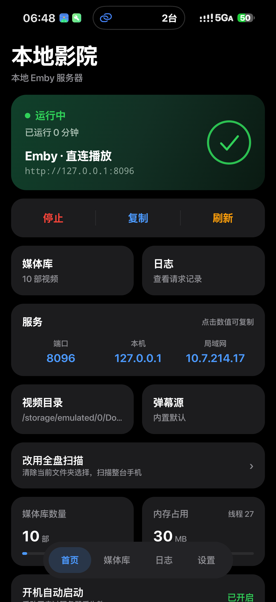
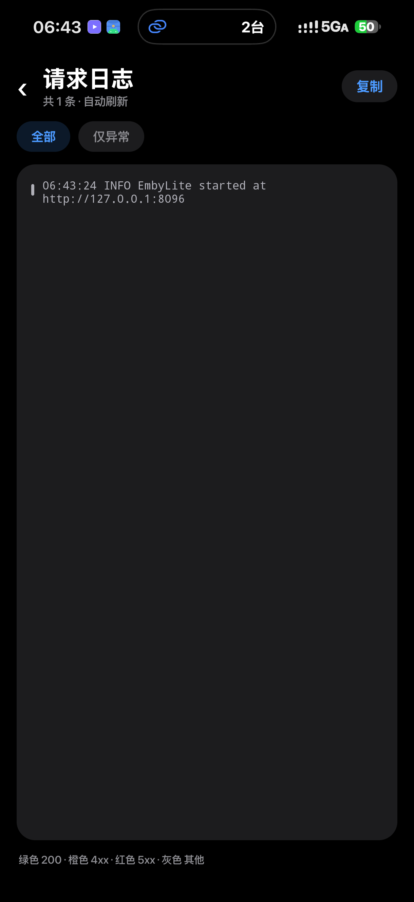

# LocalEmby（本地影院）

[](https://github.com/Dylan-1107/LocalEmby/releases/latest)
[](https://github.com/Dylan-1107/LocalEmby/releases/latest/download/LocalEmby.apk)


## 下载安装

**直接下载（永久链接，始终指向最新版）**

https://github.com/Dylan-1107/LocalEmby/releases/latest/download/LocalEmby.apk

历史版本见 [Releases](https://github.com/Dylan-1107/LocalEmby/releases)。

装好后打开 App → 授权视频目录（选择文件夹或授予全部文件访问）→ 启动服务器。与手机同一 Wi-Fi 的设备，请在 Emby 客户端添加 App 显示的“局域网”地址（例如 `http://192.168.1.23:8096`）；只有本机客户端使用 `http://127.0.0.1:8096`，用户名密码随意填。

## 界面

| 首页 | 请求日志 |
| --- | --- |
|  |  |

把手机里的本地视频目录，变成一个**支持本机和局域网访问的 Emby 服务器**。装好之后，本机客户端添加 `http://127.0.0.1:8096`，同一 Wi-Fi 的其他设备添加 App 显示的局域网地址，就能像浏览真 Emby 一样浏览、播放本地视频，并且**播放进度会记忆、可续播**，还支持**自动匹配弹幕**。

> 本项目是为了解决一个具体问题：想在 Emby 客户端里看手机本地视频，又不想为此专门跑一台 NAS / Jellyfin。它在手机本地模拟 Emby Server 的 HTTP API，零依赖、零转码，全部直连播放。

## 功能

- **HyperOS 风格界面**：基于 [Miuix](https://github.com/compose-miuix-ui/miuix)（Compose Multiplatform UI 库）重写，卡片式布局、系统级观感

- **本地目录即媒体库**，两种授权方式：
  - **选择文件夹（SAF）**：逐个目录授权，可持久化、不需要危险权限；Android 11+ 系统不允许选存储根目录，所以只能选具体文件夹
  - **所有文件访问权限**：在系统设置里一次性授予 `MANAGE_EXTERNAL_STORAGE`，之后直接扫全盘，无需选目录（本项目不上架 Play，不受其政策限制）
- **Emby API 模拟**：实现登录、媒体库、条目列表/详情、PlaybackInfo、图片、视频流（HTTP Range 拖动）、播放进度上报等接口
- **续播与进度记忆**：通过 Emby 的 `PlaybackPositionTicks` 协议上报，客户端原生「继续观看」生效；多个客户端共享同一份进度
- **剧集识别**：结合**父目录名与文件名**解析「剧名 / 季 / 集」（`SxxExx`、`第N集`、`EPxx`、纯数字等），区分「明确季」「未分季」「特别篇」，并把多集合并、上下篇等文件标记为**命名有歧义**，不参与自动绑定
- **剧集结构浏览**：Emby 客户端里按「剧集 → 季 → 集」层级浏览（`/shows/{id}/Episodes`、`/shows/nextup`、`/items`），不再把所有文件摊平成电影
- **自动弹幕**：客户端请求 `/api/danmu/{itemId}` 时，按**剧集身份**（剧名 + 季 + 集）匹配弹弹play 兼容弹幕源，并对候选做二次校验，避免错绑同名剧集；绑定结果带指纹缓存（弹幕源 / 路径 / 大小 / 身份），文件或配置变化会自动失效重识
- **识别结果可视化**：首页「剧集与弹幕识别」卡片显示识别进度、每个文件的绑定状态（已绑定 / 命名有歧义 / 待确认候选 / 未找到匹配 / 网络失败），候选可一键确认，失败可重新识别
- **刮削元数据**：支持通过 `/api/dev/metadata` 注入标题、简介、年份、评分、演职人员、海报
- **后台常驻**：前台服务 + WakeLock + 开机自启（仅在你主动开启过服务器时恢复）
- **请求日志**：App 内可查看全部请求，便于排查客户端兼容问题

## 目录结构

```
app/
  src/
    AndroidManifest.xml
    com/local/embylite/
      EmbyHttpServer.java   # 原生 HTTP 服务器：路由、Range 流媒体、弹幕/元数据接口
      EmbyApi.java          # Emby 协议层：System/Users/Items/PlaybackInfo/Sessions 等
      VideoLibrary.java     # 媒体库扫描（SAF / MediaStore / 目录遍历）
      Item.java             # 条目模型 + 文件名剧集解析（SxxExx、第N集、EPxx）
      EpisodeIdentity.java  # 剧集身份解析：父目录 + 文件名 → 剧名/季/集，标记歧义与特别篇
      EpisodeMatcher.java   # 弹幕剧集绑定：搜索、校验、缓存（带指纹）、进度
      EpisodeMatchPolicy.java # 候选校验策略（纯 Java，独立回归测试）
      DanmuNetwork.java     # 弹幕源网络层（OkHttp + HTTPS DNS 兜底）
      ProgressDb.java       # 播放进度存储（Emby ticks）
      MetadataStore.java    # 刮削元数据覆盖层
      DanmuProxy.java       # 弹幕源代理（match + comment）
      ThumbProvider.java    # 视频抽帧缩略图 / 占位图
      HttpService.java      # 前台服务
      MainActivity.kt       # 主界面（Miuix/Compose）：启停、地址复制、目录选择、端口、弹幕源
      LogActivity.java      # 请求日志
      Settings.java         # 偏好设置
      BootReceiver.java     # 开机恢复
    res/                    # 布局与资源
  assets/web/index.html     # 浏览器调试页（列表 + 播放 + 进度上报）
tests/
  EpisodeRegression.java    # 剧集解析 / 候选校验回归测试（纯 Java，无需设备）
```

## 构建

需要 JDK 17 与 Android SDK（compileSdk 36 / build-tools 36.0.0）。

```bash
# 1. 配置 SDK 路径
echo "sdk.dir=/path/to/android-sdk" > local.properties

# 2. 打包
./gradlew assembleRelease
# 产物：app/build/outputs/apk/release/app-release.apk
```

签名默认使用仓库根目录的 `debug.keystore`（`signingConfigs.local`），正式发布请替换为你自己的密钥。

技术栈：AGP 8.13.2 · Kotlin 2.3.20 · Compose Multiplatform 1.10.3 · Miuix 0.8.8 · minSdk 26 / targetSdk 36。

### 剧集解析回归测试

剧集身份解析与候选校验是纯 Java 逻辑，改完命名规则后先跑一遍回归，不需要设备或 Gradle：

```bash
javac -encoding UTF-8 -d build/regress \
  app/src/com/local/embylite/EpisodeIdentity.java \
  app/src/com/local/embylite/EpisodeMatchPolicy.java \
  app/src/com/local/embylite/Item.java \
  tests/EpisodeRegression.java
java -cp build/regress com.local.embylite.EpisodeRegression
# 期望输出：PASS <n> episode identity and candidate regression cases
```

## 使用

1. 安装 APK，打开「本地影院」
2. 点「选择文件夹」授权视频目录（或用输入框手填路径，支持 `/sdcard/xxx` 写法）
3. 点「启动服务器」，界面会显示本机地址和局域网地址（点「复制」会复制局域网地址）
4. 在同一 Wi-Fi 的 Emby 客户端里添加服务器：填写界面显示的局域网地址，例如 `http://192.168.1.23:8096`；如果客户端就在手机本机，再填写 `http://127.0.0.1:8096`。用户名密码随意填
5. 浏览播放即可，进度自动记忆

局域网内其他设备也可以访问 `http://<手机IP>:8096`（同 WiFi）。

## 弹幕

客户端会向服务器请求 `/api/danmu/{itemId}?option=GetJsonById`。服务端**先建立「文件 → 弹幕剧集」绑定**，再取该剧集的弹幕：

```
POST {base}/api/v2/match          {"fileName":"..."}  → matches[0].episodeId
GET  {base}/api/v2/comment/{id}  ?withRelated=true    → {count, comments:[{p,m}]}
```

绑定不是简单取 `matches[0]`：`EpisodeMatchPolicy` 会用本地解析出的「剧名 / 季 / 集」去校验每个候选的标题与集号，只有**剧名归一化后一致、集号相同、季信息不冲突**才接受。

- **明确季**的文件（`S02E03`、`第二季第3集`）必须有季证据才能绑定，避免第二季被绑到第一季
- **未分季**的文件只会绑定到同样未分季的候选；**特别篇**（`S00`）不会绑到正片
- **命名有歧义**的文件（`S01E01-E02` 合集、上下篇等）不参与自动绑定，需拆分后重识
- 绑定结果按「弹幕源 + 路径 + 大小 + 解析身份」生成指纹缓存，任一变化即失效重识；首页卡片可查看进度、确认候选、重新识别

弹幕源地址在 `Settings.getDanmuApi()` 中配置（默认值见 `DanmuProxy.DEFAULT_API`，可自行替换为你部署的弹弹play 兼容服务）。网络层（`DanmuNetwork`）在系统 DNS 失败时走 DoH 兜底，同时保留原始主机名、SNI 与证书校验。

> 弹幕内容来自第三方服务，本项目不存储、不提供任何弹幕内容。

## 已实现的主要接口

| 接口 | 说明 |
|---|---|
| `GET /System/Info[/Public]` | 服务器信息 |
| `POST /Users/AuthenticateByName` | 登录（任意账号密码），返回 `AuthenticationResult` |
| `GET /Users/{uid}/Views` | 媒体库视图 |
| `GET /Users/{uid}/Items` | 条目列表（分页、排序、搜索、ParentId 过滤） |
| `GET /Users/{uid}/Items/Latest`、`/Items/Resume` | 最新 / 继续观看 |
| `GET /Users/{uid}/Items/{id}` | 条目详情（含 Series / Season 虚拟条目） |
| `GET /Shows/{seriesId}/Episodes`、`/Shows/{seriesId}/Seasons` | 剧集 → 季 → 集层级浏览 |
| `GET /Shows/NextUp` | 下一集 |
| `POST /Items/{id}/PlaybackInfo` | 播放信息（直连播放，缺失时长时自动探测） |
| `GET /Videos/{id}/stream` | 视频流，支持 HTTP Range |
| `GET /Items/{id}/Images/Primary` | 缩略图 / 刮削海报（Series / Season 复用代表帧） |
| `POST /Sessions/Playing[/Progress|/Stopped]` | 播放进度上报 |
| `GET /api/danmu/{id}` | 弹幕代理（按剧集绑定） |
| `GET /api/episodes/status` | 剧集识别进度与每个文件的绑定状态 |
| `POST /api/dev/metadata` | 注入刮削元数据 |
| `GET /api/dev/log` | 请求日志 |

## 已知限制

- **不做转码**：只提供直连播放，客户端需自行支持文件编码（Hills / YAmby 内置 mpv，支持良好）
- **无用户体系**：任意账号密码都能登录，仅建议本机或可信局域网使用
- **无 WebSocket**：部分客户端的实时会话推送不可用，不影响播放
- **APK 体积约 7MB**：Compose 运行时占用较大
- **`MediaStreams` 为占位信息**：部分客户端会显示固定的 1080p H.264 / AAC，实际轨道由播放器自行探测
- 小米等 ROM 对后台限制较严，若服务器被杀，可在系统设置里允许自启动并锁定后台

## 免责声明

本项目仅用于**管理和播放你自己拥有的本地媒体文件**，不提供、不索引、不托管任何影视内容。刮削与弹幕数据来自第三方公开服务，请遵守相应服务条款与当地法律法规。
